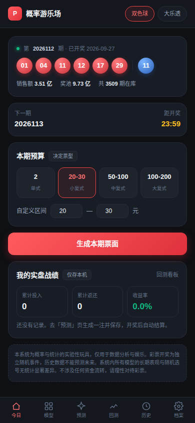
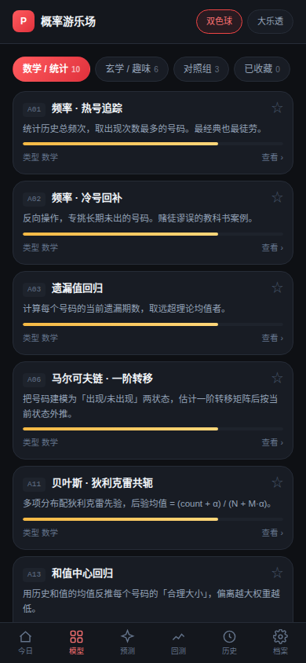
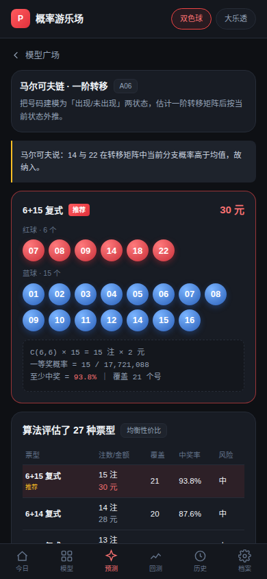
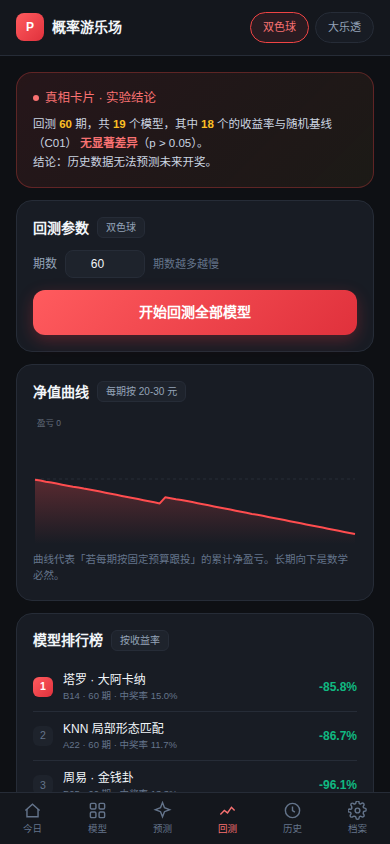

# 概率游乐场 · Probability Playground

双色球 / 大乐透的**单机版**概率实验玩具。不联网、无账号、不涉及任何资金流转。

把 6400+ 期真实开奖数据摊开，让 **78 个模型**（数学 50 / 玄学 25 / 对照 3）同台竞技，
按你设定的预算自动编排票面（单式 / 复式 / 胆拖），长期记录战绩，最后诚实地告诉你结论。

> **这个系统的核心产出不是"预测号码"，而是一个结论**：所有模型（包括马尔可夫链和塔罗牌）的长期表现，
> 与随机选号没有统计显著差异。系统会亲手把这个结论展示给你看。

---

## 截图

| 今日选号 | 模型广场 |
|---|---|
|  |  |

| 票型评估 | 回测排行榜 |
|---|---|
|  |  |

---

## 快速开始

```bash
npm install
npm run dev        # 开发模式，默认 http://localhost:5173
npm run build      # 构建到 dist/
npm run preview    # 预览构建产物
```

环境要求：Node.js 20+。

---

## 打包 APK

Android 平台已配置好（`android/` 目录已生成），只需执行：

```bash
npm run cap:sync   # 构建 + 同步到 Android 工程
npx cap open android   # 用 Android Studio 打开
```

在 Android Studio 中：`Build → Build Bundle(s) / APK(s) → Build APK(s)`。

命令行构建：

```bash
export JAVA_HOME=/opt/jdk21          # Capacitor 7 要求 JDK 21
export ANDROID_HOME=/opt/android-sdk # Android SDK 34 + build-tools 34
cd android && ./gradlew assembleDebug
# 产物：android/app/build/outputs/apk/debug/app-debug.apk
```

**环境要求**：JDK 21（Capacitor 7 的 `capacitor-android` 模块声明了 source 21）、
Android SDK platform 34 与 build-tools 34。国内网络建议给 Gradle 配镜像仓库，
否则 Gradle 分发包与依赖下载会非常慢。

仓库根目录已附一份编译好的 Debug 包：`概率游乐场-v1.0-debug.apk`（约 4.3 MB，debug 签名，
内含全部 6438 期数据，**完全离线可用**）。安装时允许「未知来源」即可。

---

## 网页版（三种用法）

| 用法 | 产物 | 说明 |
|---|---|---|
| **单文件** | `网页版-单文件版.html` | 数据已内联，**双击即可打开**，`file://` 也能跑 |
| **可部署** | `网页版-可部署/` | 自有 HTML + JS + 数据，丢到任意静态托管即可 |
| **本地开发** | `npm run dev` | http://localhost:5173 |

```bash
npm run build:single   # 生成 dist-single/index.html（单文件版）
npm run build          # 生成 dist/（可部署版）
```

> 单文件版为什么要把 1.1 MB 数据内联？因为以 `file://` 双击打开时，
> 浏览器会拦截对本地 JSON 的 fetch（CORS）。内联后网页版才真正做到「打开就能用」。

**网页版的限制**：受浏览器同源策略约束，无法直连官方开奖接口，
新增数据需重新导入数据包。想要自动更新，用桌面端或 APK。

---

## 桌面端（Windows / macOS / Linux）

基于 **Tauri 2**：前端 Vue 代码 100% 复用，Rust 侧只做一件事——提供原生 HTTP 通道，
绕开浏览器的同源策略，让桌面端也能**直接抓取最新开奖数据**。

```bash
npm run desktop:dev     # 开发模式
npm run desktop:build   # 构建当前平台
npm run desktop:win     # 交叉编译 Windows exe（需 mingw-w64）
```

环境要求：Rust 1.77+、平台 WebView 运行时（Windows 用 WebView2，Win10/11 自带）。
Linux 首次构建还需：`libwebkit2gtk-4.1-dev libssl-dev librsvg2-dev` 等系统库。

---

## 内置数据

`public/data/lottery-data.json`（约 1.1 MB，已内置）：

| 彩种 | 期数 | 区间 | 来源 |
|---|---|---|---|
| 大乐透 | 2929 | 07001（2007-05-30）→ 26111 | 体彩官方接口 |
| 双色球 | 3509 | 2003001（2003）→ 2026112 | 福彩官方接口 + 500.com 补全 |

重新抓取（脚本在仓库外 `../scripts/fetch_data.py`）：

```bash
python3.11 ../scripts/fetch_data.py --out public/data/lottery-data.json
```

> 注意：双色球 2003–2012 段来自 500.com，**无奖池与奖级数据**，仅用于频次统计，
> 默认不参与回测。

---

## 架构

```
UI 层      Vue 3 + TypeScript + Tailwind          src/views/
业务层     模型引擎 / 票面引擎 / 回测引擎          src/core/
数据层     StorageAdapter（IndexedDB/LocalStorage）src/adapters/
抓取层     NetAdapter（三通道，自动探测）          src/adapters/net.ts
           ├─ Tauri        → Rust 原生层（桌面端，可直连）
           ├─ Capacitor    → OkHttp 原生层（Android，可直连）
           └─ Packet       → 离线数据包（纯网页，不能直连）
原生后端   src-tauri/src/lib.rs                   http_get 命令
```

| 目录 | 说明 |
|---|---|
| `src/core/lottery.ts` | 彩种规则、组合数、奖级判定、奖金表 |
| `src/core/ticket.ts` | 票型枚举、**精确概率计算**、预算优选打分 |
| `src/core/backtest.ts` | 回测引擎、置换检验 |
| `src/core/backtestRunner.ts` | 分片执行器（可中断、可续算、逐位可复现） |
| `src/core/perf.ts` | 耗时预估唯一公式源 + 本机校准 |
| `src/core/models/` | 78 个模型，统一 `Model` 接口 |
| `src/adapters/storage/` | SQLite / IndexedDB / 内存三端存储适配 |
| `src/stores/main.ts` | Pinia 状态与业务编排 |

---

## 核心算法

### 1. 统一模型接口

所有模型（不论数学还是玄学）输出**同一结构**的概率分布，票面引擎一视同仁：

```ts
interface Prediction {
  frontProbs: number[]   // 每个号码的概率权重
  backProbs: number[]
  narrative: string      // 一句话解释
  confidence: number
}
```

塔罗牌抽到「命运之轮」就是给对应数字加权，格式上和马尔可夫链没有任何区别。
这样才能在排行榜上公平竞技。

### 2. 票型精确概率

**复式**（双色球 `n 红 + m 蓝`）：

```
P(命中 k 个红球) = C(6,k) · C(27,n−k) / C(33,n)
P(中蓝球)        = m / 16
```

**胆拖**（`a 胆 + b 拖 + m 蓝`）：

```
P(胆中 i、拖中 j) = C(a,i) · C(b,j) · C(33−a−b, 6−i−j) / C(33,6)
最佳单注命中数     = i + min(j, 6−a)
```

### 3. 一个必须知道的数学事实

> **一等奖概率 = 注数 / 总组合数，与票型无关。**
> 70 注的胆拖和 70 注的单式，头奖概率完全相同。

票型真正改变的是**奖金分布形状**，不是期望值（每注 2 元的期望价值固定）。
所以打分函数不看期望，而看这三个维度：

| 维度 | 说明 |
|---|---|
| `pWin` | 至少中奖概率。双色球中 `P_win ≈ m/16`（中蓝球即保底六等奖） |
| `coverage` | 覆盖号码数 |
| `variance` | 奖金方差（胆拖远高于复式） |

三种偏好因此会选出不同票型（已测试验证）：

| 偏好 | 典型结果 | 逻辑 |
|---|---|---|
| 稳健回本 | `6+15 复式` | 堆蓝球，中奖率 93.8% |
| 均衡性价比 | `6+15 复式` | 中奖率与单位成本概率质量并重 |
| 激进博高奖 | `5胆15拖` | 铺开 21 个号，接受高方差 |

---

## 模型清单（78 个）

### 数学 / 统计（50）

**基础统计 A01–A20**：热号追踪、冷号回补、遗漏值回归、均值回归 MA、指数平滑 EWMA、
马尔可夫链（一阶 / 二阶 / 号码对共现）、泊松拟合、二项显著性检验、贝叶斯（狄利克雷 / 拉普拉斯）、
和值中心回归、跨度极值、AC 值、奇偶大小比、三区比、连号模式、重号概率、尾数分布、同尾号共现

**进阶统计与信息论 A21–A35**：Apriori 关联规则、互信息 PMI、卡方检验、游程检验、
蒙特卡洛、Bootstrap、最大熵、AR 自回归、傅里叶频谱、Hurst 指数、PCA、K-Means、PageRank

**优化与机器学习 A36–A50**：遗传算法、粒子群 PSO、模拟退火、随机森林、梯度提升树、
逻辑回归、线性 SVM、MLP、循环网络（ESN）、隐马尔可夫 HMM、自编码器异常检测、
多臂老虎机 UCB、覆盖设计、正交拉丁方、反向指标

> A36–A50 标记为**重量模型**：搜索类与神经网络类计算昂贵（单次 predict 可达 150 ms）。
> 回测**固定跑全部 78 个模型，不提供跳过开关** —— 证伪的前提是「连最会过拟合的模型都赢不了随机」，
> 这个条件不能交给使用者去破坏。

### 玄学 / 趣味（25）

**日期驱动（12，零输入）**：B01 天干地支、B02 五行生克、B03 河图洛书、B04 玄空飞星、
B05 金钱卦、B06 梅花易数、B07 纳甲筮法、B08 六十四卦、B09 奇门遁甲、B18 数字根、B21 黄历宜忌、B22 二十八宿

**个人命理（6，需档案）**：B10 紫微斗数、B11 八字四柱、B12 生肖、B13 星座、B17 生命灵数、B24 姓名笔画

**随机 / 手动（7）**：B14 塔罗大阿卡纳、B15 凯尔特十字、B16 小阿卡纳、B19 卢恩符文、
B20 卡巴拉、B23 梦境数字、B25 民间抽签

> 个人命理类的数据**仅存本机，永不上送**，可一键清空。

### 对照组（3）

C01 真随机均匀（黄金基线）、C02 恒定号码、C03 机选模拟

---

## 测试与验证

```bash
npm run typecheck        # vue-tsc 类型检查
npm run verify           # 离线断言套件：核心算法 + 存储契约（含 fake-indexeddb）
npm run smoke            # 运行时冒烟
npm run smoke:browser    # 真浏览器冒烟（本地 Chrome + CDP）
npm run probe:info:ui    # 页面上每个数字与独立真值逐项比对
npm run probe:persist:ui # 档案改完即存 / 刷新不丢（跑在 http 上，file:// 不给 IDB）
npm run probe:detail:ui  # 逐期明细弹框
npm run probe:perf       # 回测耗时曲线拟合，校验 core/perf.ts 的系数
```

覆盖内容包括：

- 组合数、双色球 / 大乐透全部奖级判定
- 票型成本公式（7+2 = 14 注 = 28 元）
- **一等奖概率恒等于 注数 / 总组合数**（误差 < 1e-9）
- 概率归一性、各模型输出结构一致性
- 三种偏好必须选出不同票型
- 回测引擎在可预测数据上盈利、在真实数据上必然亏损
- 增量补算逐位等于全量重算（引擎版本一变即整体重算）

真实数据回测结果（120 期，预算 20–30 元）：

| 模型 | 收益率 |
|---|---|
| A01 热号追踪 | -83.9% |
| A06 马尔可夫链 | -84.0% |
| A22 KNN 形态 | -77.9% |
| B01 天干地支 | -72.1% |
| C01 真随机基线 | -83.3% |

玄学模型"打败"了两个数学模型——这就是随机性本身，也是本系统要展示的核心事实。

---

## 免责声明

本系统为概率与统计的实验性玩具，仅用于数据分析与娱乐。彩票开奖为独立随机事件，
历史数据不能预测未来。系统内所有模型的长期表现与随机选号无统计显著差异，
本系统会如实展示这一结论。本系统不提供购彩、代购、荐号服务，不涉及任何资金流转。
请理性对待彩票，量力而行。

---

## 开源协议

[MIT](LICENSE) © 2026 wuyunjiegithub

开奖数据来自体彩 / 福彩官方公开接口与 500.com，仅作社会公开数据的统计展示之用。
